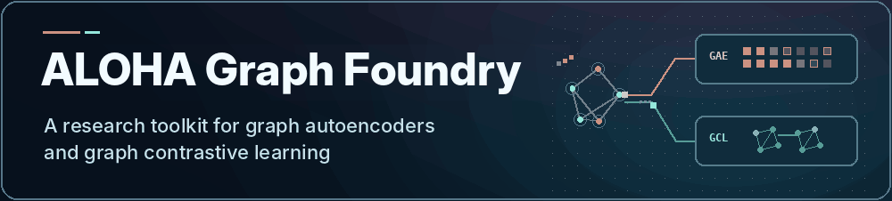

<h1 align="center">
  
</h1>

<p align="center">
  <a href="https://pytorch.org/"></a>
  <a href="https://www.dgl.ai/"></a>
  <a href="https://pytorch-geometric.readthedocs.io/"></a>
  <a href="https://ogb.stanford.edu/"></a>
  <br>
  <a href="#quick-start"><strong>🚀 Quick start</strong></a> ·
  <a href="#model-zoo"><strong>🧠 Model zoo</strong></a> ·
  <a href="#data"><strong>🗃️ Data</strong></a> ·
  <a href="#experiment-records"><strong>📊 Experiment records</strong></a>
</p>

---

## 🧭 Overview

**ALOHA Graph Foundry** is a research workbench for **graph autoencoders (GAE)** and **graph contrastive learning (GCL)**. It grew out of day-to-day experiments with graph representation learning and brings model implementations, dataset adapters, downstream evaluation, and saved experiment logs into one repository.

[The shared runner](./Train_Runner.py) selects a model and task. The model's own training code controls its configuration, data backend, and evaluation. The checked-in experiments cover node classification, graph classification, and link prediction, with clean and precomputed perturbed graphs available through the dataset loaders.

<a name="quick-start"></a>

## 🚀 Quick start

### Environment

The original setup used **Linux**, **PyTorch 1.8.0**, **DGL 0.6.1 with CUDA 10.2**, and **PyTorch Geometric 2.2.0**. [`requirements.txt`](./requirements.txt) records that environment. For a new machine, replace its local package and wheel references with distributions compatible with your Python, PyTorch, and CUDA versions. The shared runner imports the registered models at startup, so the environment must satisfy those imports even when you run a single model.

### Run GraphMAE on clean Cora

Run from the repository root so the model can resolve its [dataset-specific YAML settings](./model_zoo/GAE/GraphMAE/configs.yml).

```bash
python Train_Runner.py --help

python Train_Runner.py \
  --model_name GraphMAE \
  --task nodecls \
  --dataset Cora \
  --mode tranductive
```

The runner uses `tranductive` as the CLI spelling for transductive training. The GraphMAE node classifier also has `inductive` and `mini_batch` code paths. Supported modes and datasets depend on the selected model. Set `--model_name` explicitly because the parser defaults to `MaskGAE`, whose entry points are currently disabled in the runner's export list.

<a name="model-zoo"></a>

## 🧠 Model zoo

The table reflects model and task names currently dispatched by [`model_zoo/__init__.py`](./model_zoo/__init__.py). It describes the runner's registrations. Check the individual trainer for data paths, mode support, and compatibility with the current parser.

| Task flag | Registered model names |
| --- | --- |
| `nodecls` · Node classification | `GraphMAE`, `GraphMAE2`, `SPMGAE`, `DiffMGAE`, `RobustGAE`, `VGAE`, `DGI`, `MVGRL`, `STABLE`, `GCN`, `GAT` |
| `graphcls` · Graph classification | `GraphMAE`, `SPMGAE`, `DiffMGAE`, `InfoGraph`, `MVGRL`, `GIN` |
| `linkcls` · Link prediction | `VGAE` |

The source tree also contains [GRACE](./model_zoo/GCL/GRACE), [MaskGAE](./model_zoo/GAE/MaskGAE), [S2GAE](./model_zoo/GAE/S2GAE), [GAE](./model_zoo/GAE/GAE), and [BGRL](./model_zoo/GAE/BGRL) experiments. Their imports and exports are commented out in the shared runner. The InfoGraph and MVGRL graph-classification trainers still check the legacy `graph` task label internally, while the runner dispatches them under `graphcls`.

<a name="data"></a>

## 🗃️ Data and sampling

| Component | What it provides |
| --- | --- |
| [`datasets_dgl/`](./datasets_dgl) | DGL loaders for clean datasets such as Cora, CiteSeer, and PubMed, plus adapters for precomputed robustness benchmarks and OGB. |
| [`datasets_pyg/`](./datasets_pyg) | PyG dataset adapters and a checked-in precomputed Cora benchmark example. |
| [`datasets_graphsaint/`](./datasets_graphsaint) and [`sampler/`](./sampler) | GraphSAINT-format data loading and subgraph sampling utilities. |
| [`visualization/`](./visualization) | Helpers for graph and embedding visualization. |

Several historical loaders use absolute paths from the original workstation. For those experiments, configure the dataset and checkpoint paths for your machine before running. The clean Cora example uses the standard DGL dataset loader.

<a name="experiment-records"></a>

## 📊 Experiment records

[`logs/`](./logs) contains historical experiment output, including full-batch and mini-batch runs for GraphMAE and GraphMAE2, along with records for several other architectures. Log filenames identify the model, dataset, perturbation setting, and training mode where applicable. Use the files to inspect past runs and compare configurations.

[`train_all_attack.sh`](./train_all_attack.sh) is the original batch launcher. Its arguments are model, dataset, and training mode, and it assumes precomputed local data, specific GPU indices, and existing log directories. [`train.sh`](./train.sh) and the other shell launchers record additional machine-specific setups. Start with the single-run command above when bringing up a new environment.
